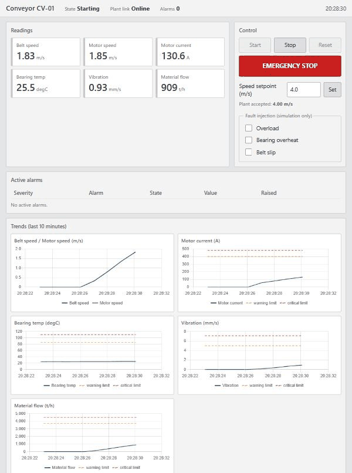

# Mine Conveyor OT Simulator and HMI

A simulated mine conveyor and a web-based HMI that monitors and controls it over Modbus TCP. It is built
the way a small operational technology (OT) system is structured: a device that serves registers, and a
separate supervisory system that knows only the register map.



*Recorded from the running system and sped up. The sequence is start, overload, acknowledge, belt slip, emergency stop, reset.*

## What it does

**Simulator (the plant)**
- Models belt and motor speed, motor current, bearing temperature, vibration and material flow
- Injects four faults through Modbus: overload, bearing overheat, belt slip and emergency stop
- Serves everything as a Modbus TCP device, running a PLC-style scan every 100 ms

**HMI (the supervisory side)**
- Polls the plant once a second and pushes live state to the browser over WebSocket
- Shows readings and ten minutes of trends with alarm limit lines
- Starts, stops, resets, emergency-stops and sets the speed remotely
- Raises warning and critical alarms with a delay, a deadband and acknowledgement
- Logs every alarm event and operator action to SQLite, including writes the plant could not be reached for
- Treats lost communication as an alarm and blanks its readings rather than showing frozen values

## Tech stack

| Part | Choice |
|---|---|
| Language | Python 3.12 |
| Device protocol | Modbus TCP with pymodbus |
| Backend | FastAPI, WebSocket, uvicorn |
| Frontend | Plain JavaScript, Chart.js |
| Logging | SQLite |
| Configuration | YAML for the register map, plant parameters and alarm limits |
| Testing | pytest, pytest-asyncio |
| Packaging and CI | Docker Compose, GitHub Actions |

## Running it

You need Python 3.12 or newer.

Windows:

```powershell
python -m venv .venv
.venv\Scripts\python.exe -m pip install -e ".[dev]"
.venv\Scripts\python.exe run.py
```

Linux:

```bash
python3 -m venv .venv
.venv/bin/python -m pip install -e ".[dev]"
.venv/bin/python run.py
```

Then open <http://127.0.0.1:8000>. `run.py` starts both processes, and stops both if either one exits.

The trend charts load Chart.js from a CDN, so they need internet access. Ports and the database path can be
changed by copying `.env.example` to `.env`.

With Docker instead:

```bash
docker compose up --build
```

To try it, press **Start**, wait for the belt to reach speed, and then tick a fault under **Fault injection**.
Overload and belt slip raise alarms within seconds. Bearing overheat takes about three minutes to reach
its critical alarms, because it heats up gradually.

To run the tests (Windows; on Linux use `.venv/bin/python`):

```powershell
.venv\Scripts\python.exe -m pytest
```

To check a running system from the outside:

```bash
python scripts/smoke_test.py http://127.0.0.1:8000
```

## Project layout

```
simulator/plant.py         Physics and state machine; pure logic with no network or clock
simulator/server.py        Modbus server and scan cycle
hmi/plant_client.py        Modbus client
hmi/alarms.py              Alarm engine; pure logic
hmi/service.py             Poll loop and operator actions
hmi/logbook.py             SQLite log
hmi/app.py                 REST and WebSocket API
hmi/static/                Web page
shared/                    Register map and settings, used by both sides
config/                    registers.yaml, plant.yaml, alarms.yaml
scripts/smoke_test.py      End-to-end check of a running system
run.py                     Starts everything
```

## Documentation

- [Register map](docs/registers.md): every address, scale and range
- [Architecture](docs/architecture.md): system and sequence diagrams, and decisions with their costs
- [Alarm logic](docs/alarms.md): the state machine, all limits and where they came from

`tests/test_docs.py` fails if the register and alarm tables stop matching the configuration.

## Design decisions

**Two processes that only share Modbus.** The HMI never imports the simulator, and a test enforces that. A
real PLC serving the same register map could replace the simulator with no HMI changes.

**A PLC-style scan that cannot be interrupted.** Each scan reads the controls, steps the physics and publishes
the readings without yielding to the event loop, so a client can never read half-updated registers. A test
pins this, so a library upgrade that breaks it would be noticed.

**Alarms work from measurements.** The HMI does not read the injected-fault flags for its process alarms. It
detects slip from the difference between motor and belt speed, as it would have to on real equipment.

**Alarm limits come from data.** My first estimated limits raised false alarms at maximum speed. The current
ones come from 20 simulated hours, and tests check both that six healthy hours raise nothing and that each
fault is caught.

**No data is not good news.** When communication is lost, readings go blank and a critical alarm raises. Other
alarms hold their state, because silence is not evidence that a problem went away.

**Time is an input to the physics.** The model has no clock and only moves in `step(dt)`, so tests can simulate
hours in moments. Bearing temperature uses an exact solution for each step, so at constant speed the result does not depend on
the step size. While the belt speeds up it does: an 8-second start-up gives 27.3 °C in 0.1 s steps and 29.5 °C
in one 8 s step. The server always steps every 0.1 s, so this only matters to tests that take big steps.

## Known limitations

**Security**
- Modbus TCP has no authentication, and the HMI has no login or protection against cross-site requests. It is only suitable for one trusted machine, which is why everything binds to `127.0.0.1` by default and Docker Compose does not publish the Modbus port.

**Alarms**
- Alarm states live in memory. After an HMI restart they are worked out again from fresh readings.
- There is no alarm shelving, so an emergency stop can leave many alarms to acknowledge one by one.
- Flow and current limits are absolute, so an overload at nominal speed usually reaches only warning level.
- Belt slip is not detected below 0.5 m/s.

**HMI**
- A successful command only means the Modbus write worked. Whether the plant accepted it shows in the run state afterwards.
- A new setpoint is clamped and written back by the plant on its next scan, up to 0.1 s later, so a read straight after the write can still show the requested value.
- Requests the HMI refuses itself, such as an out-of-range value or an alarm with nothing to acknowledge, get an error reply but are not logged.
- Trend data lives in the page, so a reload clears it.
- Chart.js comes from a CDN, so trend charts do not work offline. The page loads it asynchronously, so everything else works while it is slow or missing. A real plant network usually has no internet access, so a real deployment would need a local copy.
- The JavaScript has no automated tests. It was checked by hand in a browser.

**Simulation**
- The plant parameters are plausible rather than taken from a real site, and thermal behaviour is sped up so a demo shows faults within minutes.
- It is one simulated conveyor with one device, and it has never been connected to real industrial hardware.
- The simulator checks its port is free before starting, but two simulators started at the same instant on Windows can both pass the check and share the port. Starting through `run.py` or Docker Compose avoids this.
- pymodbus stores coils in 16-bit words, so unused coil addresses 7 to 15 can be read and written but do nothing.

## Testing

- **Unit tests** cover the physics, the alarm engine and the configuration loaders.
- **Integration tests** run a real Modbus server, a real client, real HTTP and WebSocket connections and a real SQLite file.
- **Process tests** run `run.py` itself and check that it starts, works, and leaves nothing running when it stops.
- **CI** runs the tests on Linux, builds the containers, starts them, and runs the smoke test against them.
- I also checked the tests by deliberately breaking the plant, server and HMI code in a throwaway copy, one change at a time, and adding tests for anything they missed. That was a manual check, and it is not part of CI.

Docker Compose has only been run in GitHub Actions, because my development machine does not have Docker.
