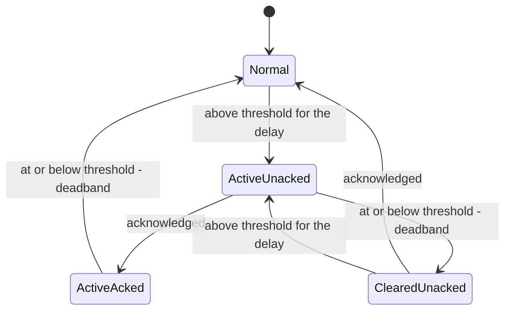

# Alarm logic

The engine is in [`hmi/alarms.py`](../hmi/alarms.py) and the limits are in
[`config/alarms.yaml`](../config/alarms.yaml). `tests/test_docs.py` fails if the table below stops
matching that file.

## How an alarm is decided

Each alarm watches one signal and has three settings:

- **Threshold:** the alarm can raise once the signal goes above this.
- **Delay:** the signal must stay above the threshold this long before the alarm raises. A dip below the threshold restarts the timer, so a brief spike raises nothing.
- **Deadband:** once raised, the alarm only clears when the signal is back at `threshold - deadband`, so noise around the threshold cannot make it switch on and off repeatedly.

Delay and deadband solve different problems. Delay rejects spikes on the way up, and deadband stops
chatter on the way down.

Warning and critical levels are separate alarms on the same signal, so at a critical level both are
active. Each has its own record and is acknowledged on its own.

## Alarm states

An alarm stays on screen until it is both over and acknowledged, so a brief one cannot go unseen. Every
raise, acknowledgement and clear is written to the `alarm_events` table in SQLite, and every operator
action, including failed ones, to `operations`.

## Alarm table

| Alarm | Signal | Severity | Raises above | Clears at | Delay (s) | Message |
|---|---|---|---|---|---|---|
| `bearing_temp_high` | `bearing_temp` | warning | 85 | 82 | 3 | Bearing temperature high |
| `bearing_temp_critical` | `bearing_temp` | critical | 110 | 105 | 3 | Bearing temperature critical |
| `vibration_high` | `vibration` | warning | 5.0 | 4.7 | 3 | Bearing vibration high |
| `vibration_critical` | `vibration` | critical | 7.1 | 6.6 | 3 | Bearing vibration critical |
| `motor_current_high` | `motor_current` | warning | 400 | 385 | 2 | Motor current high |
| `motor_current_critical` | `motor_current` | critical | 480 | 465 | 2 | Motor overcurrent |
| `material_flow_high` | `material_flow` | warning | 3700 | 3550 | 2 | Material flow high |
| `material_flow_critical` | `material_flow` | critical | 4500 | 4350 | 2 | Material flow overload |
| `belt_slip_warning` | `slip_ratio` | warning | 0.1 | 0.07 | 2 | Belt slipping |
| `belt_slip_critical` | `slip_ratio` | critical | 0.25 | 0.22 | 2 | Belt slipping badly |
| `emergency_stop` | `emergency_stop` | critical | 0.5 | 0 | 0 | Emergency stop active |
| `comm_lost` | `comm_lost` | critical | 0.5 | 0 | 0 | Lost communication with the plant |

## Derived signals

These are worked out in the HMI from what crosses the wire:

| Signal | Definition |
|---|---|
| `slip_ratio` | `(motor_speed - belt_speed) / motor_speed`, or 0 when the motor is below `slip_min_speed` (0.5 m/s), where the ratio of two small noisy numbers means nothing |
| `emergency_stop` | 1 when the emergency stop bit of `fault_code` is set, otherwise 0 |
| `comm_lost` | 1 when a poll fails, otherwise 0 |

## How the limits were chosen

The limits come from 20 simulated hours of the real plant parameters, not from estimates. An early
estimated set raised false alarms at maximum speed.

| Case | Motor current | Material flow | Vibration |
|---|---|---|---|
| Healthy at 4 m/s, peak | 276 A | 2394 t/h | 2.2 mm/s |
| Healthy at 6 m/s, peak | 393 A | 3591 t/h | 4.6 mm/s |
| Overload at 4 m/s, median | 421 A | 4014 t/h | 2.0 mm/s |

Warnings sit just above the healthy peak. Two tests keep this honest: six simulated hours of healthy
running at both speeds must raise nothing, and each injected fault must raise its alarms within ten
minutes at nominal speed.

| Injected fault | Alarms at nominal speed |
|---|---|
| Overload | `material_flow_high`, `motor_current_high`; critical levels need a higher belt speed or a feed peak |
| Bearing overheat | `bearing_temp_high`, `vibration_high`, `vibration_critical`, `bearing_temp_critical`, in about 3 minutes |
| Belt slip | `belt_slip_warning`, `belt_slip_critical` |
| Emergency stop | `emergency_stop` |

## When communication is lost

Only `comm_lost` has a value during an outage. The other alarms hold their state: an active alarm stays
active, because no data is not evidence that the problem went away. Any delay that was counting restarts,
because nothing is known about the time in between. Readings in the API become null.

## Limitations

- Alarm states live in memory. After an HMI restart, active alarms are worked out again from fresh readings, and unacknowledged cleared ones are gone from the screen, though still in the log.
- There is no alarm shelving or suppression. An emergency stop or an outage can leave many alarms to acknowledge, one by one.
- Slip below 0.5 m/s is not detected.
- Absolute limits on flow and current do not change with the speed setpoint, which is why an overload at nominal speed only reaches warning level.
