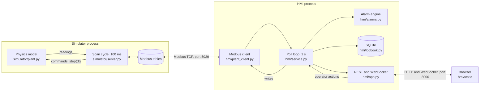
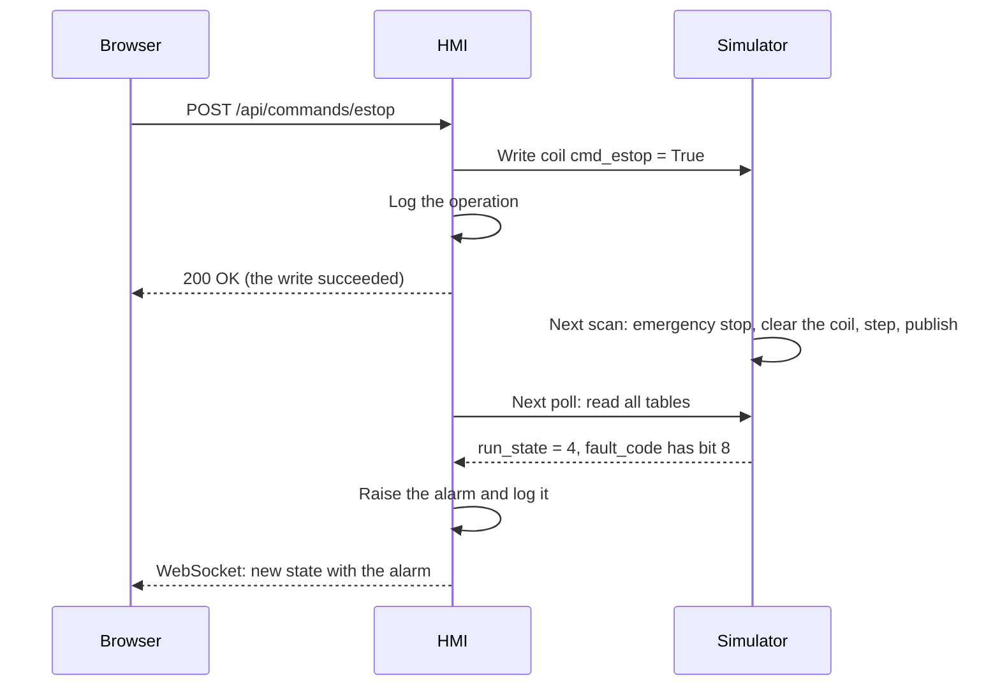

# Architecture

Two processes that only talk over Modbus TCP, the way a PLC and a SCADA or HMI system do on a real site.
The HMI knows the register map and nothing else about the simulator, and a test checks that `hmi/` never
imports `simulator`. Replacing the simulator with a real PLC that serves the same map would need no HMI
changes.

## One operator action, end to end

A 200 reply only means the Modbus write succeeded. Whether the plant accepted the command shows up in
`run_state` on a later poll, which is also how a real PLC behaves.

## Key decisions

| Decision | Why | Cost |
|---|---|---|
| The plant is pure logic and time only moves in `step(dt)` | Tests simulate hours in a moment, with repeatable results | The server has to supply the clock |
| Bearing temperature uses the exact solution of a first-order model | At constant speed the result does not depend on the step size | Only works because the model is this simple; while the belt speeds up, large steps still drift |
| Separate random generators for the process and for sensor noise | How often the HMI polls cannot change how the plant behaves | None worth noting |
| The server runs a PLC-style scan: read controls, step, publish | Commands take effect at a known point in the cycle | Up to one scan of delay on every command |
| A scan never yields to the event loop | Clients cannot read half-updated registers or write between a read and a clear; a test pins this | A slow scan would hold up requests |
| Alarms come from measurements, not from knowing a fault was injected | It is all a real HMI could do, so the alarm logic is honest | Limits had to be chosen from long simulated runs |
| Readings go null when communication is lost | A frozen number on a gauge looks like a healthy plant | The page has to handle missing data everywhere |
| A crashed scan or poll loop ends the process | Better than a live server that serves stale data | `run.py` then stops the whole system |
| Each WebSocket client keeps only the latest state | A slow browser skips updates and cannot hold up polling | That client misses trend points |
| SQLite calls run on the event loop | One thread, so the connection needs no locking | A very slow disk would delay polling |

## Running it

| Way | Command | Notes |
|---|---|---|
| Local | `python run.py` | Starts both processes and stops both if either one exits |
| Containers | `docker compose up --build` | Modbus stays on the compose network; the HMI is published on `127.0.0.1:8000` only |

`scripts/smoke_test.py` checks a running system from the outside, and GitHub Actions runs it against
docker compose on every push to `main` and every pull request.

## Security boundary

Modbus TCP has no authentication and the HMI has no login, so this design is only suitable for a single
trusted machine. Both default to `127.0.0.1`, and compose does not publish the Modbus port. The HMI API
also has no protection against cross-site requests, so a page open in the same browser could send it
commands. That is acceptable for a local simulation and would have to change before any real use.
